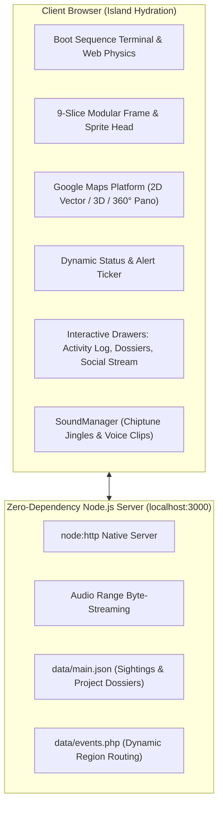

# 🕸️ Cyber-Tracker Portfolio Template

[](https://nodejs.org/)
[](https://astro.build/)
[](server.js)
[](LICENSE)
[](index.html)

An interactive, retro cyber-terminal portfolio template styled as a surveillance tracker command center. Features an interactive global vector map, live activity ledger, classified dossier drawers, chiptune sound triggers, 9-slice CRT frames, and mathematical CSS `clip-path` stepped pixel borders.

Designed as a high-impact, memorable showcase for creative developers, engineers, and designers.

---

## 🏛️ Architecture Overview



### Key Technical Highlights
* **Zero External NPM Dependencies**: Built completely on Node.js standard libraries (`node:http`, `node:fs`, `node:path`, `node:url`) for instantaneous startup and zero package drift.
* **Procedural Stepped Pixel Borders**: Uses dynamic CSS `clip-path: polygon(...)` with `evenodd` fill rules (`bitBorder3Step.js`) to generate crisp 8-bit notched borders mathematically without raster blurring.
* **Audio Engine with Range Streaming**: Supports Web Audio playback with categorized sound triggers (`preloader`, `notification`, `activity`, `webwatch`, `general`) and HTTP byte-range audio streaming.
* **Multi-Layered Map Engine**: Configured for Google Maps Platform with custom dark cyber themes, filterable pin tiers, and 360° Street View panorama modals.

---

## ⚡ Quickstart

### Prerequisites
* [Node.js](https://nodejs.org/) (v18 or higher)

### Run Locally

```bash
# 1. Clone the repository
git clone https://github.com/kishore-1404/portfolio-template.git
cd portfolio-template

# 2. Start the local server
npm start
# or
node server.js
```

Open your browser to:
* **Primary Console**: [http://localhost:3000/](http://localhost:3000/)
* **Regional Endpoint**: [http://localhost:3000/intl/in/](http://localhost:3000/intl/in/)

---

## 🛠️ Customization Guide: Building Your Portfolio on This

This template was customized for **Anshul** to build a one-of-a-kind interactive engineering portfolio. Here is how you can personalize each module:

### 1. Map Career Milestones & Experience (`data/main.json`)
The interactive map pins are defined inside the `spideyPins` array in [`data/main.json`](data/main.json):
* Change `title` to your job role or company (e.g., `"Senior Systems Engineer @ TechCorp"`).
* Update `lat` and `lng` to the coordinates of your work location or remote hub.
* Set `pinType`:
  * `"confirmed"` (Green): Full-time roles, verified milestones.
  * `"rumored"` (Red/White): Hackathons, side projects, open-source contributions.
* Add description and media preview URLs.

```json
{
  "id": "role-techcorp",
  "pinType": "confirmed",
  "lat": 37.7749,
  "lng": -122.4194,
  "title": "Staff Architect @ Acme Corp",
  "cardThumbImg": "./images/portfolio/thumb_acme.jpg",
  "createdAt": "2026-01-01T00:00:00.000Z"
}
```

### 2. Feature Projects as Classified Dossiers (`data/main.json`)
The **Web Watch** drawer (accessed via the top-right `WEB WATCH` button) serves as an intel archive. In your portfolio, transform this into your **Case Studies & Project Dossiers**:
* Edit `webwatch.articles` in [`data/main.json`](data/main.json).
* Replace character entries with your flagship projects (e.g., Distributed Payment Engine, AI Coding Assistant, Real-Time Physics Renderer).

```json
{
  "image": "./images/projects/payment-engine.jpg",
  "name": "DISTRIBUTED LEDGER ENGINE",
  "desc": "High-throughput fintech transaction engine built with Kafka, Redis locks, and ACID minor-unit precision."
}
```

### 3. Personalize Audio Greetings & Chimes
* Add your custom voice greeting or audio intro clips in [`sounds/`](sounds/).
* Register them in `registeredSounds.ned_bites` inside [`data/main.json`](data/main.json) under the `"preloader"` or `"notification"` categories.

### 4. Custom Directive & Footer Branding
* The directive message below the console can be customized directly in [`index.html`](index.html#L535):
  ```html
  <h2 class="custom-message-title">Hi Anshul, I want you to build your portfolio on this</h2>
  ```
* Change contact links, social profiles, and resume downloads in the main navigation menu (`mainMenu` in `main.json`).

---

## 📁 Repository Structure

```
.
├── .github/workflows/       # Automated CI validation workflow
├── _astro/                  # Production CSS styles & Astro Island JS modules
├── data/
│   ├── main.json            # Core content data (Pins, Projects, Sound Triggers)
│   └── events.json          # Regional events and tour stops data
├── fonts/                   # PF Videotext Pro & Bitcount web fonts
├── images/
│   ├── frame/               # 9-slice retro CRT border slices
│   ├── ui/                  # Stepped buttons, notification drawers, pins
│   └── web_watch/           # Dossier cover images
├── scripts/                 # Client consent and helper libraries
├── sounds/
│   ├── spidey_jingle.mp3    # Chiptune notification sound
│   └── ned_sound_bites/     # Audio voice clips
├── index.html               # Main application HTML shell
├── package.json             # Package manifest
├── server.js                # Built-in HTTP server with Range streaming
└── LICENSE                  # MIT License
```

---

## 📜 License

Distributed under the **MIT License**. See [`LICENSE`](LICENSE) for full details.
